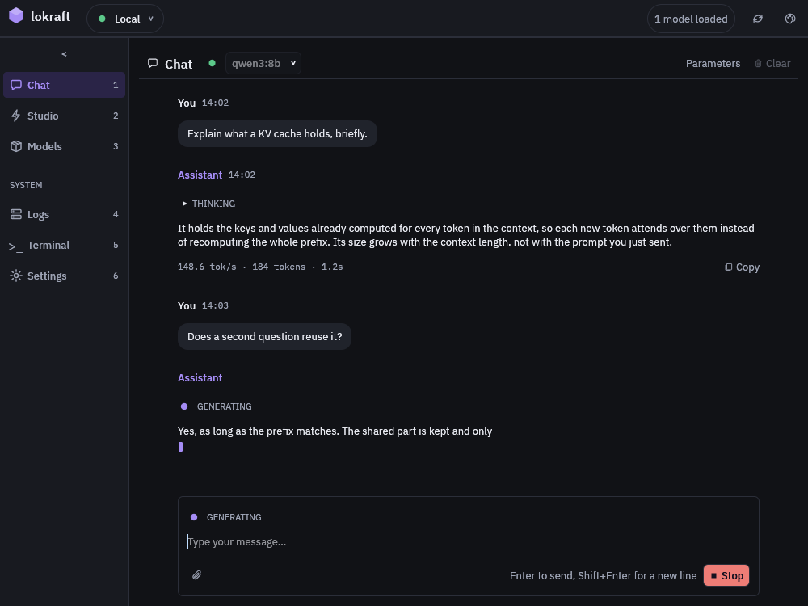

# lokraft

The desktop client for [loken](https://github.com/loken-ai/loken): a chat window, and a studio for images, audio and video.  
lokraft holds no model.
It sends every request to the loken server you name, so it runs on a laptop while the models run on the machine with the cards.



## Quick start

```sh
cargo build --release
target/release/lokraft --server http://localhost:11435
```

Linux needs the ALSA headers, `libasound2-dev`, for the audio output.
[Install](docs/start/install.md) gives the packages of each system.

## State

Version 0.1.0.
lokraft builds from source and publishes no prebuilt archive.  
The continuous integration builds and tests it on Linux.

## Documentation

| Page | What it covers |
|---|---|
| [Overview](docs/start/overview.md) | what lokraft does, view by view |
| [Install](docs/start/install.md) and [First run](docs/start/first-run.md) | from the source to a first answer |
| [Concepts](docs/start/concepts.md) | client and server, chosen model and Auto, connections |
| [Guides](docs/guides/chat.md) | 1 page per task: chat, Auto, images, audio, video, models, terminal, log, server configuration |
| [Reference](docs/reference/settings.md) | settings, Studio kinds, keyboard, command line, configuration file, server routes |

What each machine of a cluster is doing lives in [lokpit](https://github.com/loken-ai/lokpit).

## Contributing

See [CONTRIBUTING.md](CONTRIBUTING.md).

## Licence

MIT OR Apache-2.0, at your option.
