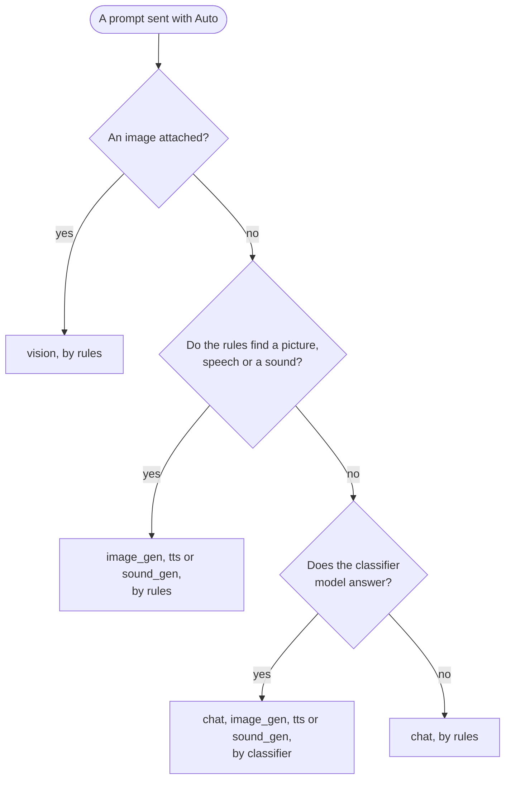

# Let the server choose the model

Auto sends each chat turn to loken's conversation route, and the server decides whether the prompt asks for an answer, a look at a picture, an image, speech or a sound.

## Before you start

<!-- site: widget checklist id=lokraft-auto-prereq -->
- [ ] lokraft is connected to a loken server, see [Connect to a server](connect.md).
- [ ] The server holds the models for the routes you expect: a chat model, a vision model, an image model, a speech model, a sound model.
<!-- site: end -->

## Smallest configuration

None.
The model chosen in the picker before Auto goes with each turn as the preferred chat model.
The server falls back to its own default when that model cannot chat.

## Run it

<!-- site: widget steps id=lokraft-auto-steps -->
1. Open Chat with `Ctrl+1`.
2. Open the model picker and pick `Auto (smart routing)`, the first row under `Filter`.
3. Type a prompt and press `Enter`.
   Attach an image for a question about a picture.
<!-- site: end -->

## Expected result

The answer arrives whole, as text, a picture or a clip.  
A toast names the route, the model and who decided: `Auto: <route> via <model> (<rules or classifier>)`.
The route reads `chat`, `vision`, `image_gen`, `tts` or `sound_gen`.  
Each turn sends the visible history of the conversation, so the answer keeps its context.

## How the server decides

The rules match the words of the prompt, such as a prompt that starts with `draw` and holds `image`, or one that starts with `say`.
The classifier is a small model of the server, and it reads only the new prompt.

## How it differs from a chosen model

| | Chosen model | Auto |
|---|---|---|
| Route | `/api/chat` | `/conversation` |
| History sent | the visible conversation for a text model, the new prompt alone for the other kinds | the visible conversation |
| Reply | streamed | whole, once ready |
| Who picks the model | you | the server, per prompt |
| Server | loken or Ollama | loken |

`Auto (smart routing)` stays on between sessions.
Picking a model in the picker leaves Auto.  
`Clear` starts a new conversation on the server side too.
The `Parameters` of the header and the seed lock do not apply to Auto.

## Troubleshooting

| Symptom | Cause | Fix |
|---|---|---|
| `Smart routing failed: HTTP error: ... failed with status 404 Not Found: ...` | The server has no conversation route, as Ollama. | Use a loken server, or pick a model. |
| `Smart routing failed: Request error: request timed out (...)` | The route took longer than the client waits. | Pick the model directly, or ask for less. |
