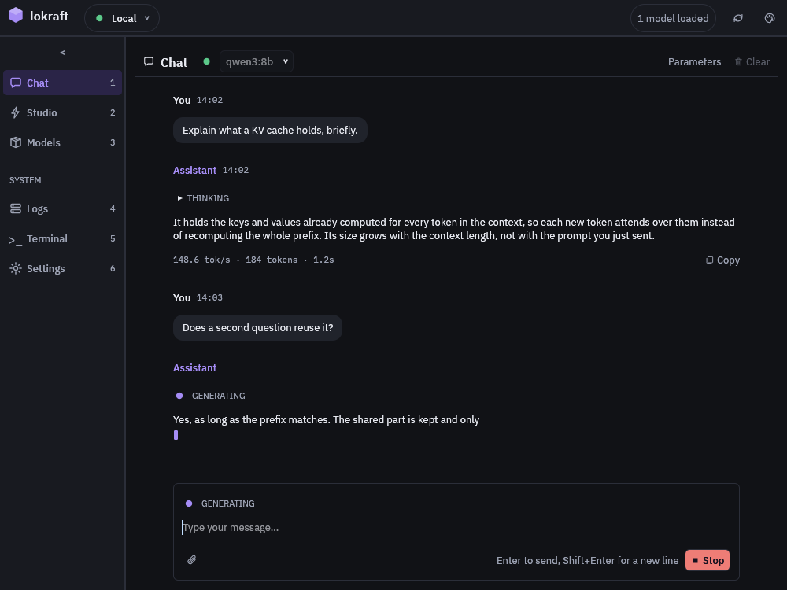

# Chat with a model

Send a prompt to the model of your choice and read its reply as it streams, with an image or an audio file attached when the model takes one.

## Before you start

<!-- site: widget checklist id=lokraft-chat-prereq -->
- [ ] lokraft is connected, see [Connect to a server](connect.md).
- [ ] The server holds at least 1 model, see [Manage models](manage-models.md).
<!-- site: end -->

## Smallest configuration

None.
The `Parameters` button of the header sets the sampling options, see [Settings](../reference/settings.md#generation-parameters).

## Run it

<!-- site: widget steps id=lokraft-chat-steps -->
1. Open Chat with `Ctrl+1`.
2. Pick a model in the picker of the header.
   The `Filter` field at the top of the list narrows it by name.
   The list groups the models under `TEXT`, `VISION`, `IMAGE`, `TTS`, `ASR` and `VIDEO`.
   The lamp beside a model is lit when the model is loaded.
3. Attach a file with the paperclip under the text, or drop it on the window, when the model takes one.
   A text or vision model takes an image, a Whisper model takes an audio file.
4. Type the prompt and press `Enter`.
<!-- site: end -->

## Expected result

The reply streams in under the prompt.

<!-- site: widget annotated pins="32.5,10.4 88.2,10.4 95.7,10.4 25.8,33.6 32.2,44 91.8,44 27.5,67.1 24.3,94.9 89.9,94.9" id=lokraft-chat-view -->

1. The model picker, with its lamp lit when the model is loaded.
2. `Parameters`, the sampling options of the request.
3. `Clear`, which empties the conversation after a confirmation.
4. The thinking of a reasoning model, folded under `THINKING` above the answer.
5. The footer of a finished reply: its rate, its token count and its time.
6. `Copy`, which puts the reply on the clipboard.
7. A reply that streams, with a caret at its end.
8. The paperclip, which attaches an image or an audio file.
9. `Stop`, in the place of `Send` while a reply streams.
<!-- site: end -->

A model that is not loaded shows `Model not loaded: the first response will be slower while it loads into memory.` above the messages.
The first message then shows a `Loading <model> into memory` notice, and the server loads the model before it answers.

## What the input does

| Key | Effect |
|---|---|
| `Enter` | sends the prompt |
| `Shift+Enter` | breaks the line |
| `Up` on the first line, `Down` on the last | recalls the previous or the next prompt |
| `Ctrl+Up`, `Ctrl+Down` | recalls from anywhere in the prompt |
| `Esc` | stops the reply in progress |
| `Ctrl+L` | asks to clear the conversation |

`Stop` replaces `Send` while a reply streams.
The picker is locked until the reply ends or stops.  
`Clear`, at the right of the header, asks for a confirmation, then empties the conversation and the attachments.
It keeps the prompt history and the saved images, and it stays grey while a reply streams or when there is nothing to clear.

## By modality

| Model | What the input offers | What comes back |
|---|---|---|
| Text | an attached image | text, from the whole visible conversation |
| Vision | an attached image | text about the image |
| Image | `SIZE`, `STEPS`, and `STRENGTH` once an image is dropped on the window | a picture, with its seed |
| Speech | `VOICE`, `SPEED`, a character counter | a clip to play |
| Whisper | an attached audio file, the prompt optional | the transcript |
| Video | nothing, `Send` stays grey | the Studio renders video, see [Render a video](render-video.md) |

Each control of an image or speech model reads `DEFAULT` until it is moved, then `OVERRIDE`, with a button that reverts it.
A control left on `DEFAULT` sends nothing, and the server applies its own.

A picture that comes back shows its seed, with `Copy` and `Lock seed`.
`Lock seed` makes the next message reuse that seed, and the lock shows above the text as `SEED <n>` until the next send or until its close mark is pressed.  
A picture opens fullscreen with a click, see [Keyboard](../reference/keys.md#viewers).
A speech clip comes back with `Play` and `Save`.

## Troubleshooting

| Symptom | Cause | Fix |
|---|---|---|
| `No model selected` | The server holds no model, or none is picked. | Pick one, or pull one, see [Manage models](manage-models.md). |
| `Whisper requires an audio attachment.` | A Whisper model got no audio file. | Attach a WAV, MP3, FLAC, OGG, M4A or AAC file. |
| `TTS input is <n> chars; cap is <max> (split client-side).` | The text for a speech model is too long. | Split the text over several messages. |
| `Attachment too large: <file> is <n> MB (max <max>)` or `Skipped <file>: <n> MB exceeds the <max> attachment cap.` | The file passes the attachment cap. | Resize the file or split it. |
| `[Generation cancelled by user]` | `Esc` or `Stop` stopped the reply. | Send again. |
| `Request failed with status <code>: <body>` | The server refused the chat request. | Read the body, then the server's log. |
