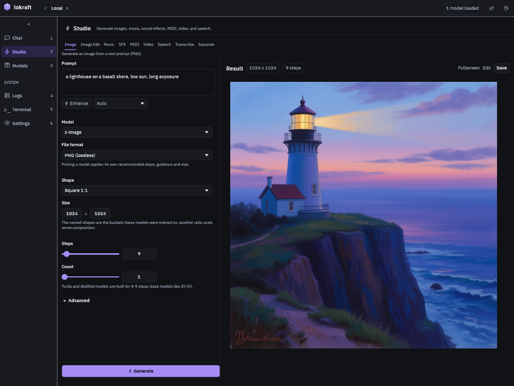

# Generate or edit an image

The Studio renders a picture from a prompt, or changes an existing picture by an instruction, with the settings of the model in front of you.

## Before you start

<!-- site: widget checklist id=lokraft-image-prereq -->
- [ ] lokraft is connected to a loken server, see [Connect to a server](connect.md).
- [ ] The server holds an image model, such as Z-Image or FLUX, and an edit model, such as FLUX Kontext, for an edit.
<!-- site: end -->

## Smallest configuration

None.
Picking a model applies the steps, the guidance and the size the server recommends for it.

## Run it

<!-- site: widget tabs group=image id=lokraft-image-kind -->
### Image

1. Open the Studio with `Ctrl+2` and pick `Image`.
2. Type the prompt.
   `Enhance` rewrites it with a chat model of the server, and `Undo` brings the old one back.
   The list beside `Enhance` picks that model, `Auto` by default.
3. Pick the `Model`, the `Shape` and the `Count`.
4. Press `Generate`, or `Ctrl+Enter`.

### Image Edit

1. Open the Studio with `Ctrl+2` and pick `Image Edit`.
2. Press `Choose image` under `Source image`.
   `Edit` on a rendered picture sends it there.
3. Type the instruction, such as `make the sky a dramatic sunset, keep everything else unchanged`.
4. Set `Strength`: 0 keeps the source, 1 renders it again.
5. Press `Generate`.
<!-- site: end -->

## Expected result

A status line follows the server's steps, and names the node that renders in a cluster.  
`Stop` tells the server to stop the render.

The picture shows under the status.
A click opens it fullscreen, with zoom and the arrow keys to step through a set.  
`Save` writes it to a file, and the previous result moves to the strip of earlier results.

## Options

| Field | What it sets |
|---|---|
| `Model`, `File format` | the image model, from what the server holds, and the file format: PNG, JPEG or WebP |
| `Shape`, `Size` | named shapes the models were trained on, or a width and height in multiples of 16 |
| `Steps`, `Count` | the denoising steps and the number of variations |
| `Sampler`, `Schedule` | the solver, for SDXL models |
| `Guidance`, `Negative` | how hard the prompt steers, and what the render steers away from |
| `Adapters` | LoRA adapters the model's architecture takes, each with a strength |
| `Pose`, `Pose strength` | a pose image for SDXL, and how hard it constrains the composition |
| `Regions` | a prompt per area of the picture, so 2 subjects stay apart |
| `Seed` | a number to repeat a result, empty for a fresh seed each run |

[Studio kinds](../reference/studio.md#image) gives the ranges and defaults.

## Troubleshooting

| Symptom | Cause | Fix |
|---|---|---|
| `No image-gen model available` | The server lists no image model. | Pull one, see [Manage models](manage-models.md). |
| `No edit-capable model available` | The server lists no edit model. | Pull one. |
| `Generate` stays grey | The prompt is empty, a render is running, or an edit has no source picture. | Fill what is missing. |
| `<file> is <n> MB; the limit is <max> MB.` | The source picture passes the upload cap. | Export it at a lower quality. |
| A red line with `failed with status 400` | The server refused a value, such as a size that is not a multiple of 16. | Read the message and change that value. |
