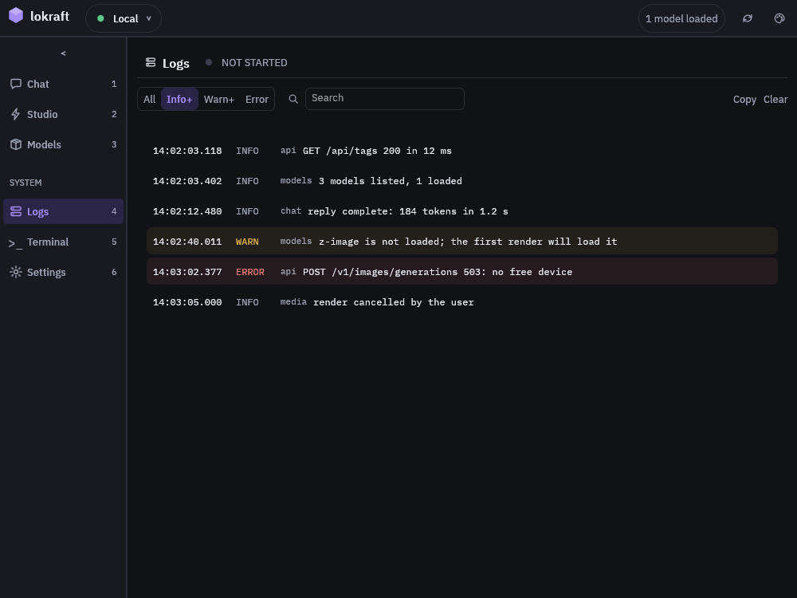

# Read the log

Logs shows the log lines of lokraft as it works: the requests it sends, the answers it gets and its own events, filtered by level and searched by text.

## Before you start

<!-- site: widget checklist id=lokraft-log-prereq -->
- [ ] lokraft is running.
<!-- site: end -->

The view, titled `Logs`, holds the lines of lokraft, never those of the server.
Its lamp reads `NOT STARTED`, since lokraft starts no server.  
The server's own log stays on the machine that runs it.

## Smallest configuration

None.
`RUST_LOG` chooses what is logged, see [Command line](../reference/command-line.md#environment).

## Run it

<!-- site: widget steps id=lokraft-log-steps -->
1. Open Logs with `Ctrl+4`.
2. Pick a level in the control at the left of the toolbar: `All`, `Info+`, `Warn+` or `Error`.
3. Type words in `Search` to keep the lines that hold them.
4. Press `Copy` to put the visible lines on the clipboard.
<!-- site: end -->

## Expected result

<!-- site: widget annotated pins="30.8,10.4 25.8,16.5 48.2,16.5 94.6,16.5 23.5,25.1 60,40.3" id=lokraft-log-view -->


1. The lamp of the view, `NOT STARTED`.
2. The level: `All`, `Info+`, `Warn+` or `Error`.
3. `Search`, which keeps the lines that hold its words.
4. `Copy` puts the visible lines on the clipboard.
   `Clear` empties the view, after a confirmation.
5. A line: its time, its level, the part of lokraft that wrote it and the message.
6. A warning or an error, on a tinted band.
<!-- site: end -->

lokraft also writes every line to its standard error.

## More detail

```sh
RUST_LOG=lokraft=debug lokraft
```

## Troubleshooting

| Symptom | Cause | Fix |
|---|---|---|
| `No logs yet` | Nothing was logged at the level `RUST_LOG` sets. | Send a chat message or refresh the models, or raise the level. |
| `No line matches` | The level or the search hides every line. | Pick `All` and empty `Search`. |
