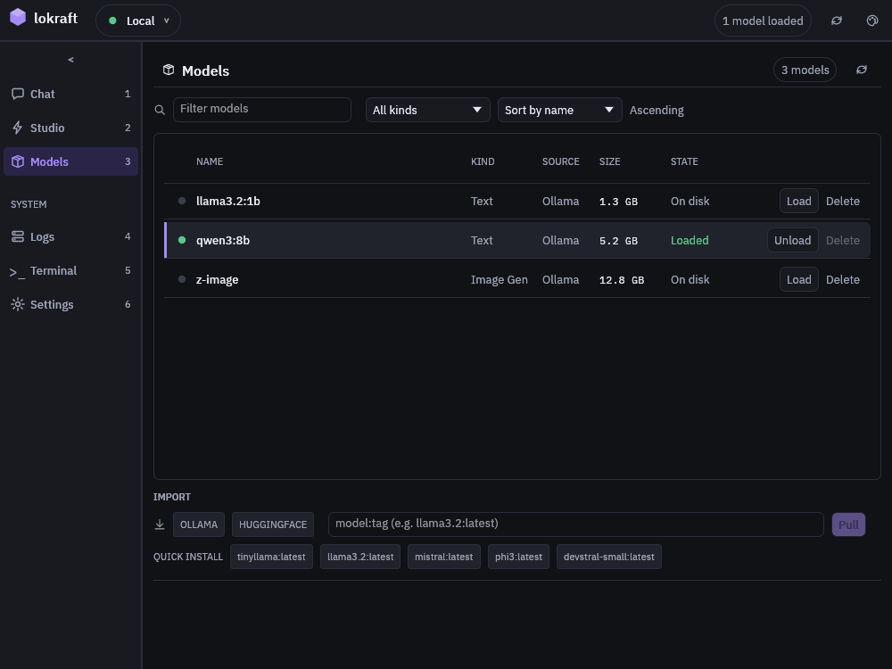

# Manage models

Models lists what the server holds, loads and unloads a model, deletes one from the server's disk and pulls a new one from Ollama or Hugging Face.

## Before you start

<!-- site: widget checklist id=lokraft-models-prereq -->
- [ ] lokraft is connected, see [Connect to a server](connect.md).
- [ ] For a pull: the server can reach the registry.
<!-- site: end -->

## Smallest configuration

None.

## Run it

<!-- site: widget steps id=lokraft-models-steps -->
1. Open Models with `Ctrl+3`.
2. Narrow the list with `Filter models`, by name, and the kind list: `All kinds`, `Text`, `Vision`, `Image`, `Speech`, `Transcription` or `Video`.
   `Clear filters` empties both.
3. Sort it with the sort list: `Sort by name`, `Sort by size` or `Sort by date`.
   The button beside it, `Ascending` or `Descending`, reverses the order.
4. Press `Load`, `Unload` or `Delete` on a row.
   A click elsewhere on the row selects the model for the chat.
5. Pull a new model under `IMPORT`: pick `OLLAMA` or `HUGGINGFACE`, type the name and press `Pull` or `Enter`.
<!-- site: end -->

## Expected result

A row shows a lamp, the name, the kind, the source, the size and the state.
The top bar counts the loaded models.

<!-- site: widget annotated pins="29.3,16.3 47.9,16.3 62.7,16.3 19.5,35.9 77.3,35.9 88.8,35.9 27.2,78.4 64.5,78.4 50,83.2" id=lokraft-models-view -->

1. `Filter models`, by name.
2. The kind list.
3. The sort list, and the button that reverses the order.
4. A lit lamp marks a loaded model.
   A stripe marks the model selected for the chat.
5. The state, `Loaded` or `On disk`.
6. `Unload` on a loaded model, with `Delete` grey until the model is unloaded.
7. The source of a pull, `OLLAMA` or `HUGGINGFACE`.
8. The name of the model to pull, then `Pull`.
9. `QUICK INSTALL`, a pill per known model that is not on the server.
<!-- site: end -->

`Load` unloads every other loaded model first, then loads the one asked.
`Delete` stays grey while the model is loaded, so `Unload` it first.
`Delete` then asks for a confirmation, and removes the files from the server's disk.

A pull shows a progress bar with the share downloaded.
The list reloads when it ends, with a `Model <name> pulled successfully` notice.

Under `QUICK INSTALL`, a pill pulls a known model from Ollama in 1 click: `tinyllama:latest`, `llama3.2:latest`, `mistral:latest`, `phi3:latest` and `devstral-small:latest`.
A model already on the server has no pill.

## Names

| Source | A name looks like |
|---|---|
| `OLLAMA` | `name:tag`, as `llama3.2:latest` |
| `HUGGINGFACE` | `owner/repo`, as `Qwen/Qwen3-0.6B` |

The kind of a model comes from its name, see [Concepts](../start/concepts.md#modality).

## Troubleshooting

| Symptom | Cause | Fix |
|---|---|---|
| The buttons are grey, and the pointer gives `Another model action is in progress` | A load, unload, delete or pull is running. | Wait for it to end. |
| `Failed to pull <name>: ...` | The registry does not know the name, or the server cannot reach it. | Check the name on that registry, or pick the other source. |
| `the previous action never reported back (server restarted?)` | The server never answered an action. | Press the refresh button of the top bar. |
| `No models yet`, `Use the import bar below to download one.` | The server holds no model. | Pull one. |
| `No model matches`, `Change or clear the filters.` | The name or the kind hides every model. | Press `Clear filters`. |
