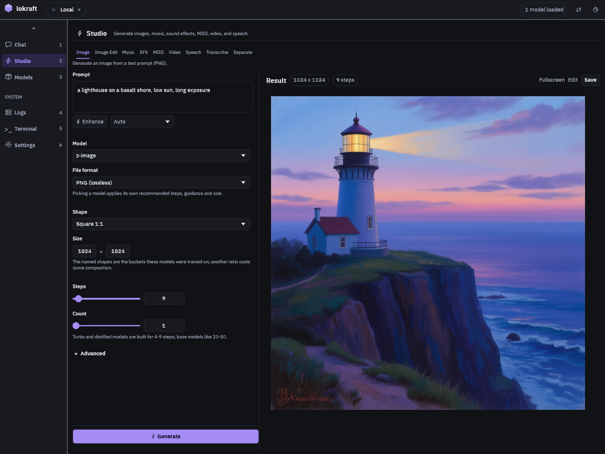
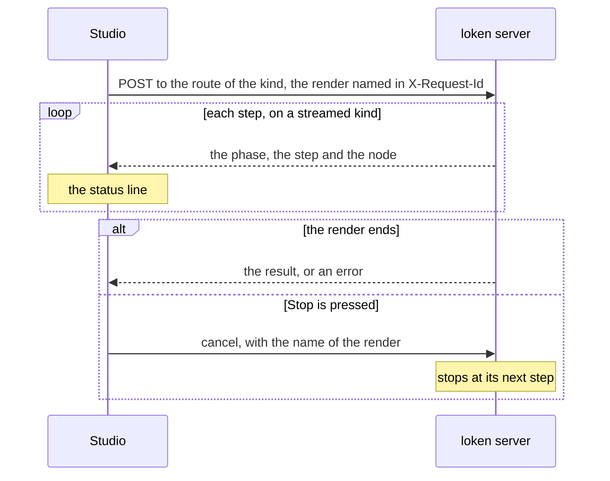

# Studio kinds

The Studio, `Ctrl+2`, has 9 kinds in its tab strip.
Each kind keeps its own settings, and lokraft saves them with the prompt when the window closes.

<!-- site: widget table id=lokraft-studio-kinds -->
| Kind | Input | Output | Route |
|---|---|---|---|
| `Image` | a prompt | PNG, JPEG or WebP | `POST /v1/images/generations` |
| `Image Edit` | a source picture and an instruction | a picture | `POST /v1/images/edits` |
| `Music` | a prompt, lyrics optional | WAV | `POST /v1/audio/generations` |
| `SFX` | a prompt, a source clip optional | WAV | `POST /v1/audio/generations` |
| `MIDI` | a prompt | a `.mid` file | `POST /v1/audio/generations` |
| `Video` | a prompt, a start frame optional | MP4 or GIF | `POST /v1/video/generations` |
| `Speech` | a text | WAV | `POST /v1/audio/speech` |
| `Transcribe` | an audio file | text | `POST /v1/audio/transcriptions`, or `/v1/audio/translations` with `to English` |
| `Separate` | a song | 1 or 2 WAV stems | `POST /v1/audio/separate` |
<!-- site: end -->

A `Seed` field left empty draws a fresh seed for each run, on the kinds that have one.
A guidance of 0 lets the server use the model's own value.
The fields are labelled in sentence case, such as `Steps` or `Guidance`.  
A window narrower than the form and the result side by side stacks them in 1 column.

`Generate` starts the render, and `Ctrl+Enter` does the same, `Cmd+Enter` on macOS.
While a render runs, the button reads `Generating...` and `Stop` appears beside it.

lokraft names each render in its request.
`Image`, `Music`, `SFX` and `Video` stream their steps, as does `Speech` when the server can.
The other kinds answer once.  
`Stop` sends the name to `POST /v1/renders/{id}/cancel`, and the server stops the render at its next step.
While no name is known, `Stop` only ends the wait, and the server finishes the render.

## Image

<!-- site: widget table id=lokraft-studio-image -->
| Control | Range | Default |
|---|---|---|
| `Model` | the image models of the server | `z-image` |
| `File format` | `PNG (lossless)`, `JPEG (small)`, `WebP (small)` | `PNG (lossless)` |
| `Shape` | 7 named shapes, or `Custom` once the size matches none | `Square 1:1` |
| `Size` | width and height, 64 to 2048, multiples of 16 | 1024 by 1024 |
| `Steps` | 1 to 200 | 9 |
| `Count` | 1 to 8 | 1 |
| `Sampler`, `Schedule` | SDXL models only: `Default`, `Euler`, `DPM++ 2M`, and `Default`, `Normal`, `Karras`, `Exponential` | `Default` |
| `Guidance` | 0 to 30 | 0 |
| `Negative` | a text | empty |
| `Adapters` | SDXL and FLUX models: the LoRA adapters of the server that fit the model, each with a strength from -1 to 2 | none |
| `Pose`, `Pose strength` | SDXL models only: a pose or edge image, then 0 to 2 | none, 1.0 |
| `Regions` | an area, a prompt and a strength from 0 to 8 each | none |
<!-- site: end -->

The named shapes are `Square 1:1`, `Portrait 4:5`, `Portrait 2:3`, `Portrait 9:16`, `Landscape 5:4`, `Landscape 3:2` and `Landscape 16:9`.  
A region covers a half or a third of the picture: left, right, top or bottom half, left, centre or right third.
`Add a region` adds a row, and the close mark removes it.  
Picking a model applies the steps, the guidance and the size the server advertises for it.

## Image Edit

| Control | Range | Default |
|---|---|---|
| `Model` | the edit models of the server, each marked `instruction edit` or `img2img` | `flux-kontext` |
| `Source image` | a picture, with a preview | none |
| `Strength` | 0 to 1 | 0.75 |
| `Steps` | 0 to 100, 0 for the model's own | 0 |
| `Guidance` | 0 to 30 | 0 |
| `Count` | 1 to 4 | 1 |
| `Negative`, `Adapters`, `Seed` | as for Image | |

## Music

<!-- site: widget table id=lokraft-studio-music -->
| Control | Range | Default |
|---|---|---|
| `Model` | the checkpoints `Turbo`, `SFT 2B`, `Base 2B`, `XL Turbo 4B`, `XL SFT 4B`, `XL Base 4B` | `Turbo` |
| `Duration` | 2 to 600 seconds | 30 |
| `Loop` | `seamless loop`, 1 to 64 bars | off, 4 bars |
| `Full length` | `force the whole duration`, on or off | off |
| `Tempo` | 40 to 220 bpm | 120 |
| `Steps` | 1 to 200 | 27 |
| `Cfg` | 1 to 10 | 3.0 |
| `Temperature` | 0.1 to 1.5 | 0.85 |
| `Top-p` | 0.1 to 1 | 0.9 |
| `Key / scale`, `Language`, `Lyrics`, `Negative` | texts | empty, `en` for the language |
<!-- site: end -->

Picking a checkpoint sets its steps and CFG.

## SFX

| Control | Range | Default |
|---|---|---|
| `Model` | the sound effect engines of the server | the first engine listed |
| `Duration` | from 1 second to the engine's limit | 10 |
| `Steps` | 1 to 200 | 60 |
| `Loop` | `seamless`, 1 to 32 bars, 40 to 300 bpm | off, 4 bars at 120 |
| `Cfg` | 0.5 to 12 | 3.0 |
| `Negative` | a text | empty |
| `Variation of`, `Strength` | a source WAV, then 0.4 to 100 | none, 1.0 |

`Loop` and `Negative` show for the engines that offer loops.
`Variation of` shows for the engines that offer variations.

## MIDI

| Control | Range | Default |
|---|---|---|
| `Max tokens` | 64 to 8192 | 512 |
| `Temperature` | 0.1 to 2 | 1.0 |
| `Top-p` | 0.1 to 1 | 0.98 |

## Video

<!-- site: widget table id=lokraft-studio-video -->
| Control | Range | Default |
|---|---|---|
| `Model` | the video checkpoints of the server | `wan` |
| `Duration` | 0.5 to 300 seconds | 3 |
| `Size` | width and height, 128 to 1280, multiples of 16 | 512 by 512 |
| `Steps` | 1 to 60 | 8 |
| `Cfg` | 0 to 15, 0 left out of the request | 0 |
| `Sampler` | `Auto`, `UniPC`, `Heun` | `Auto` |
| `Start frame` | a picture, for an image to video checkpoint | none |
| `Negative` | a text | empty |
| `Format` | `MP4`, `GIF` | `MP4` |
<!-- site: end -->

A clip runs at 16 frames per second.
lokraft asks for the smallest frame count of the form `4 x n + 1` that covers the duration.  
A prompt of several lines renders 1 scene per line.

## Speech

| Control | Values | Default |
|---|---|---|
| `Engine` | `Parler (EN)`, `Kyutai (EN/FR)`, `Piper` | `Parler (EN)` |
| `Style` | Parler only: a free description of the voice and its delivery | empty |
| `Voice` | a preset list for Parler, a voice name for Kyutai and Piper | `(default)` for Parler, empty for the others |

A `Style` overrides the preset voice.
The button beside the Parler voice list fetches the voices of the server.

## Transcribe

| Control | Values | Default |
|---|---|---|
| `Audio file` | an audio file | none |
| `Model` | a text field, empty for the model of the server | empty |
| `Language` | `Detect`, `Francais`, `English`, `Espanol`, `Deutsch`, `Italiano`, `Portugues`, `Nederlands`, `Japanese`, `Chinese`, `Russian`, `Arabic` | `Detect` |
| `Translate` | `to English` | off |

## Separate

| Control | Values | Default |
|---|---|---|
| `Track` | a song | none |
| `Stems` | `Both stems`, `Vocals only`, `Instrumental only` | `Both stems` |

## Uploads

A source picture, a start frame or an audio file over 512 MB is refused before it is sent.

## Results

The result shows under the status line, below the heading `Result`.
A new run moves the current result to the strip of earlier results, which keeps the 8 latest.  
A click on an earlier result brings it back.
`Clear` on the strip forgets them, after a confirmation.

| Result | Controls |
|---|---|
| Picture | a click opens it fullscreen, `Fullscreen`, `Edit` sends it to Image Edit, `Save` |
| Audio clip | play, pause, stop and seek, `Save` |
| File, a video or a MIDI score | an MP4 plays in the window and fullscreen with frame stepping, `Open` hands the file to the system's default app, `Save` |
| Text | `Copy text` |

The status line names the node that renders when the server reports one.
