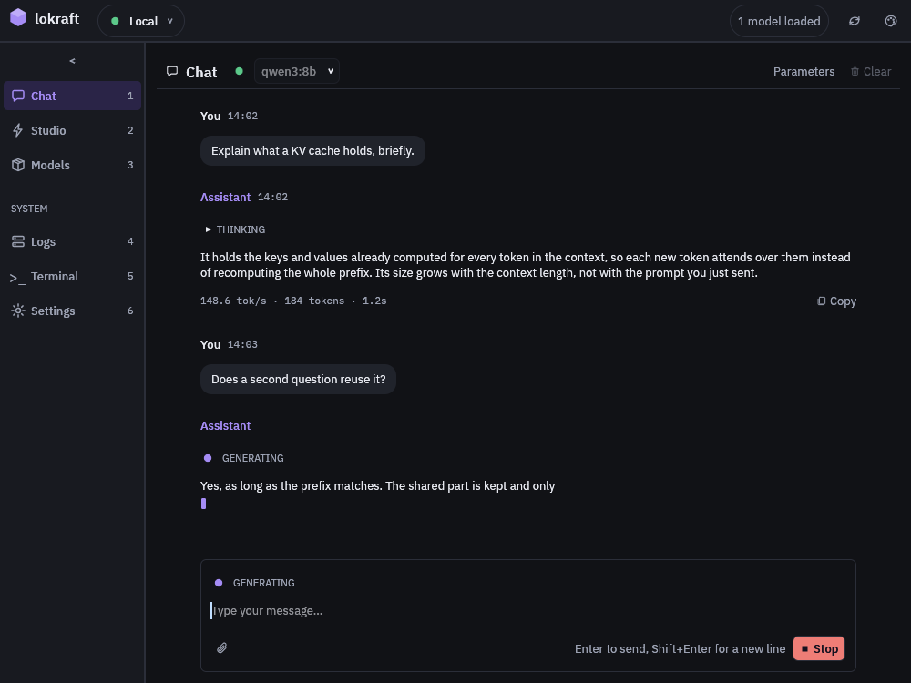

# Concepts

## Client and server

lokraft is a client.
It holds no model and runs no inference.  
A loken server owns the models, loads them and answers every request.

lokraft sends every request to 1 address, the address of the active connection.
`--server` replaces it for 1 run.  
The client and the server can run on the same machine.

Chat and Models speak the Ollama routes, which both loken and Ollama serve.
The Studio and Auto speak routes that only loken serves.  
[Server routes](../reference/server-routes.md) lists which feature calls which route.

## The 6 views

The sidebar holds 6 views, in this order, and `Ctrl` with a digit opens each one.

| Key | View | What it holds |
|---|---|---|
| `Ctrl+1` | Chat | a conversation with the chosen model, or with Auto |
| `Ctrl+2` | Studio | 1 tab per kind of render |
| `Ctrl+3` | Models | the models of the server, and the import of new ones |
| `Ctrl+4` | Logs | the log lines of lokraft |
| `Ctrl+5` | Terminal | model commands typed as text |
| `Ctrl+6` | Settings | the connections, the theme, and the form of a loken `config.toml` |

`Cmd` replaces `Ctrl` on macOS.
The top bar and the sidebar stay on every view.

<!-- site: widget annotated pins="15.5,3 85.5,3 95.8,3 7.9,8.8 11.5,19.1 7.5,30.5 32.5,10.4 88.2,10.4" id=lokraft-concepts-window -->

1. The active connection, with its status lamp.
   A click opens the list of connections.
2. The number of loaded models.
3. The refresh button, then the theme button.
4. The toggle that folds the sidebar to its icons.
5. The views, each with the digit that opens it.
6. The heading `SYSTEM`, above `Logs`, `Terminal` and `Settings`.
7. The chosen model, in the picker of the chat header.
8. The `Parameters` button, which sets the generation parameters.
<!-- site: end -->

## Chosen model and Auto

A chat turn goes to the model chosen in the picker, through `/api/chat`.
A text model answers from the visible conversation.  
The other kinds read the new prompt alone.

Auto sends the turn to the conversation route of loken instead.
The server reads the prompt and picks a chat answer, a look at an attached picture, an image, speech or a sound.  
An Auto turn carries the visible history.

## Modality

lokraft reads what a model does from its name.
A name with `whisper` is speech recognition, a name with `flux` or `z-image` is image generation, and so on.

The modality decides what the chat offers.
A vision or text model takes an attached image, a Whisper model takes an audio file, an image model shows size and steps, a speech model shows a voice and a speed.  
A video model cannot be used from the chat: the Studio renders video.

## Connections

A connection is a name, a server address and an API key when the server asks for one.
The active connection serves every request, and the top bar switches it.

## Generation parameters

The generation parameters are the sampling options of a chat request, such as the temperature or the seed.
Each one is empty until a person sets it, and the server decides what is empty.  
The `Parameters` button of the chat header sets them.

## What lokraft keeps

lokraft keeps its settings in 1 file, `config.json`, see [Configuration file](../reference/config-file.md).
The file holds the connections, the generation parameters, the theme, the window, the chosen model and every Studio parameter with its prompt.

The chat conversation lives in memory and ends with the window.  
The Studio keeps its latest results in memory, in a strip under the current one, see [Studio kinds](../reference/studio.md#results).

## Terms

| Term | Meaning |
|---|---|
| Server | The loken process that holds the models and answers requests |
| Connection | A named server address, with its API key when it has one |
| Active connection | The connection that serves every request |
| Chosen model | The model of the chat picker, which answers a chat turn |
| Auto | The chat mode in which the server picks the route of each prompt |
| Route | What Auto decided a prompt asks for: chat, vision, an image, speech or a sound |
| Modality | What a model does, read from its name: text, vision, image, speech, transcription, video |
| Kind | One tab of the Studio, such as Image, Music or Separate |
| Generation parameters | The sampling options a person set for chat requests |
| Loaded | Held in the server's memory, ready to answer |
| Pull | Download a model to the server from Ollama or Hugging Face |
