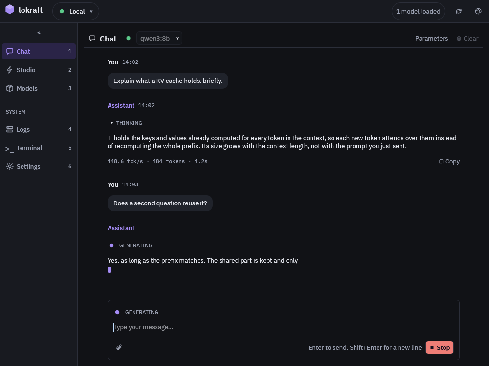

# First run

Point lokraft at a loken server, pull a model and get one answer back in the chat.

## Before you start

<!-- site: widget checklist id=lokraft-first-run-prereq -->
- [ ] `lokraft` is built, see [Install](install.md).
- [ ] A loken server runs, see [the loken first run](https://github.com/loken-ai/loken/blob/main/docs/start/first-run.md).
- [ ] The server can reach the model registry to fetch a model.
<!-- site: end -->

## Run it

<!-- site: widget steps id=lokraft-first-run-steps -->
1. Start lokraft with the address of the server.
   Leave `--server` out when the server listens on `http://localhost:11435`.

   ```sh
   target/release/lokraft --server http://localhost:11435
   ```

2. Read the top bar.
   A green lamp beside the connection name means the server answered the model list.
   The pill at the right gives the number of loaded models.

3. Open Models with `Ctrl+3`, `Cmd+3` on macOS.

4. Type `llama3.2:latest` in the field of the `IMPORT` panel, keep the source on `OLLAMA` and press `Pull`.
   A bar follows the download.
   The list reloads when the pull ends, and the model has its row.

5. Open Chat with `Ctrl+1`.

6. Check the model picker names `llama3.2:latest`, or pick it.
   With no model chosen, lokraft picks the first loaded model, else the smallest one.
   A model that is not loaded is loaded by the first message.

7. Type a prompt and press `Enter`.
   `Shift+Enter` breaks the line instead.
<!-- site: end -->

## Expected result



The reply streams in under your prompt.
Its footer reads `<rate> tok/s · <count> tokens · <time>` once the model is done.  
A reasoning model's thinking sits folded above its answer.

## Troubleshooting

| Symptom | Cause | Fix |
|---|---|---|
| A lamp that is off and a toast `Failed to list models: Request error: could not connect to the server (...)` | No server answers at the address. | Start the server, or set the address of the connection in Settings, see [Connect to a server](../guides/connect.md). |
| `Failed to list models: HTTP error: ... failed with status 401 Unauthorized: ...` | The server has `require_auth` on. | Edit the connection in Settings and enter a key of the server in `API key`. |
| `No model selected` in the chat | The server holds no model. | Pull one in Models. |
| `No models available: open the Models tab to import one` in the picker | The server holds no model. | Pull one in Models. |
| `the previous action never reported back (server restarted?)` | A load, unload or delete never got an answer. | Press the refresh button of the top bar, then try again. |
