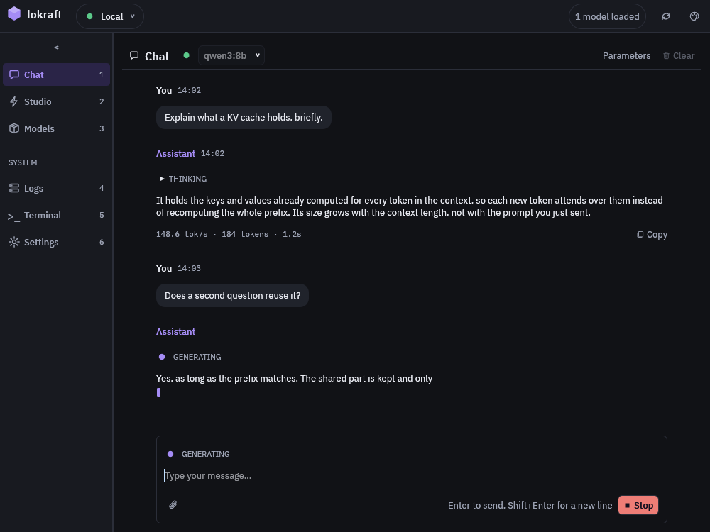
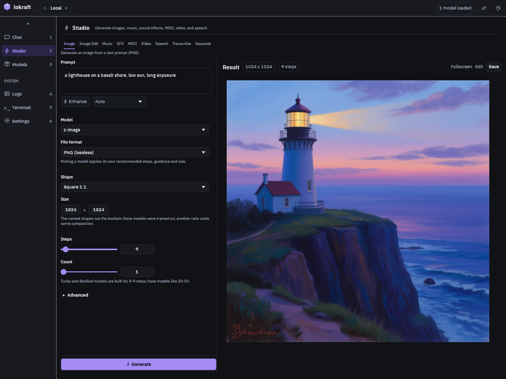
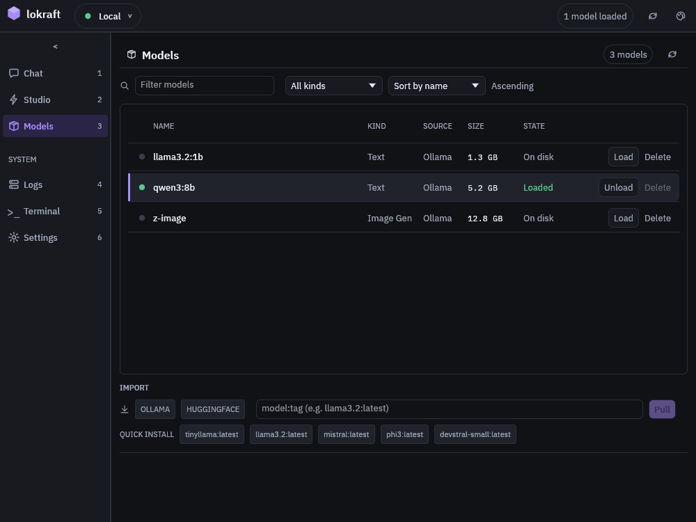
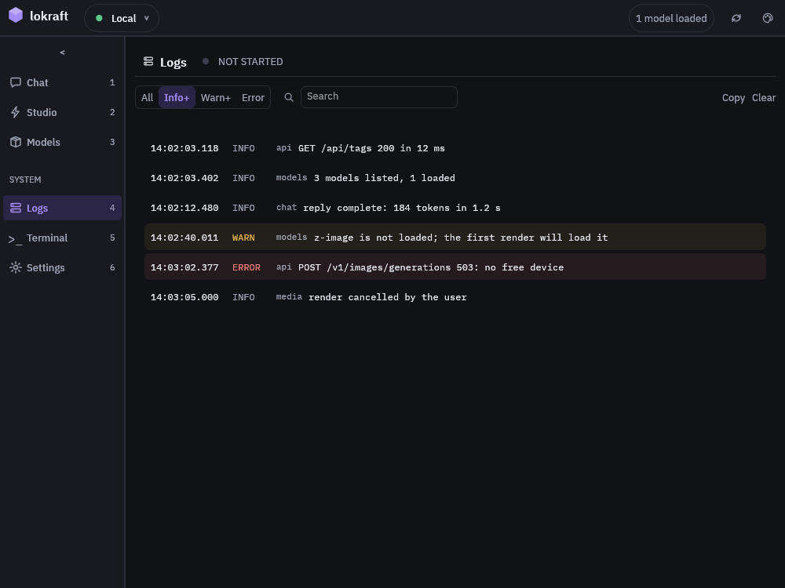

# lokraft

A desktop client for [loken](https://github.com/loken-ai/loken): a chat window and a studio for images, audio and video.  
lokraft holds no model.
It sends every request to the server of the active connection, so it runs on a laptop while the models run on the machine with the cards.

<!-- site: widget carousel id=lokraft-overview-views zoom -->


**Chat.** A reply streams in, with its rate, its token count and its time once it ends.

---



**Studio.** Each kind of render has its tab, its prompt and the settings of its model, and the result beside them.

---



**Models.** The models of the server, loaded or on disk, and the pull of a new one.

---



**Logs.** The lines of lokraft, filtered by level and searched by text.
<!-- site: end -->

## Run it

```sh
cargo build --release
target/release/lokraft --server http://localhost:11435
```

`--server` names the loken server.
Without it, lokraft uses the address of the active connection, `http://localhost:11435` on a first run.

## What it does

<!-- site: widget table id=lokraft-overview-capabilities -->
| Capability | Where | State |
|---|---|---|
| Chat with a chosen model, streamed, with the reasoning folded and the timing of each reply | Chat | Runs |
| An image for a vision model, an audio file for a Whisper model | Chat, the paperclip or a file dropped on the window | Runs |
| Image generation and speech from the chat input | Chat, with an image or speech model chosen | Runs against loken |
| Auto: the server picks the route of each prompt | Chat, `Auto (smart routing)` | Runs against loken |
| Image, image edit, music, sound effects, MIDI, video, speech, transcription, separation | Studio | Runs against loken |
| A prompt rewritten by a chat model of the server | Studio, `Enhance` | Runs against loken |
| A render stopped on the server | Studio, `Stop` | Runs against loken |
| The time a video will take, shown before the render | Studio, Video | Asks `POST /api/video/plan`, and shows nothing when the server lacks it |
| Audio and video played in the window | Studio results | Runs, audio needs the `native-audio` build feature |
| A fullscreen viewer with zoom, and frame stepping for a clip | Chat and Studio results | Runs |
| A model listed, filtered, loaded, unloaded, deleted or pulled | Models | Runs |
| Model commands typed as text | Terminal | Runs |
| The log of lokraft, by level and by text | Logs | Runs |
| Servers with their API keys, the theme | Settings, and the connection list of the top bar | Runs |
| Sampling options of a chat request | Chat, `Parameters` | Runs |
| A loken `config.toml` edited in a form | Settings | Runs when a `config.toml` sits in the working directory or beside lokraft |
<!-- site: end -->

Chat and Models also work against an Ollama server.
The Studio and Auto use routes that only loken serves, see [Server routes](../reference/server-routes.md).
